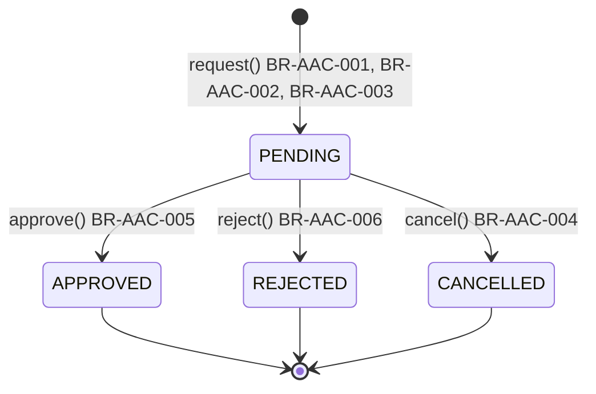
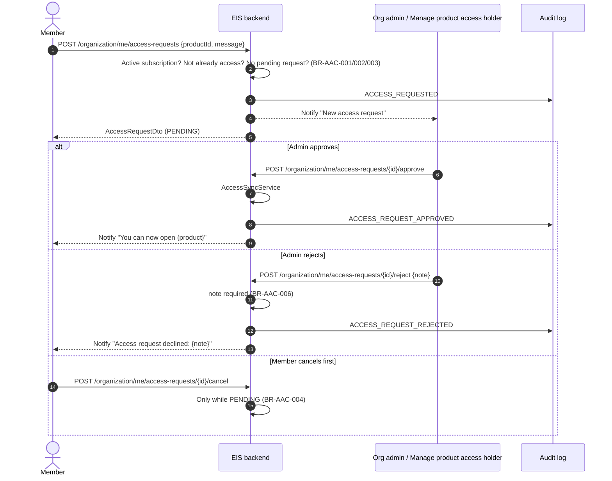
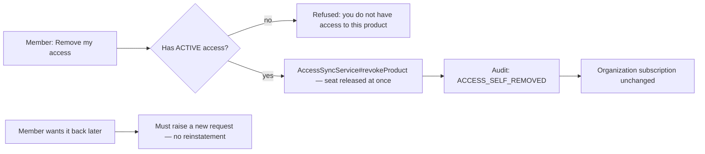
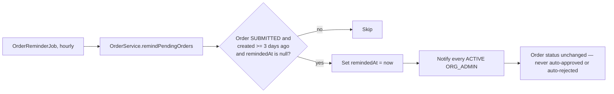

# Workflow — Application access requests (REQ-TEN-010)

## (a) Request → notify → approve/reject → grant

No PENDING request is ever auto-approved or auto-rejected (BR-AAC-007); every non-PENDING status is terminal — there is no reopening a decided request.

## (b) Self-removal — a separate, immediate flow

## (c) Order reminder — unrelated table, same sprint

## Transitions
| From | To | Actor | Condition / rule | Side effects (notifications, audit) |
|------|----|-------|------------------|-------------------------------------|
| (new) | PENDING | Active member | BR-AAC-001, BR-AAC-002, BR-AAC-003 | `ACCESS_REQUESTED` audit; notifies org admins / *Manage product access* holders |
| PENDING | APPROVED | Org admin / *Manage product access* holder | BR-AAC-005, BR-AAC-007 | Grants access (seat check); `ACCESS_REQUEST_APPROVED` audit; notifies requester |
| PENDING | REJECTED | Org admin / *Manage product access* holder | BR-AAC-006, BR-AAC-007 | `ACCESS_REQUEST_REJECTED` audit; notifies requester with the reason |
| PENDING | CANCELLED | The requester | BR-AAC-004 | No notification; request becomes historical |
| ACTIVE access | INACTIVE (self-removal, not a request) | The member themself | BR-AAC-010 | `ACCESS_SELF_REMOVED` audit; seat released; organization subscription untouched |
| SUBMITTED order (≥3 days, unreminded) | SUBMITTED order (reminded) | `OrderReminderJob` (scheduled) | BR-AAC-012 | Notifies every ACTIVE `ORG_ADMIN`; `remindedAt` set; status never changes |
