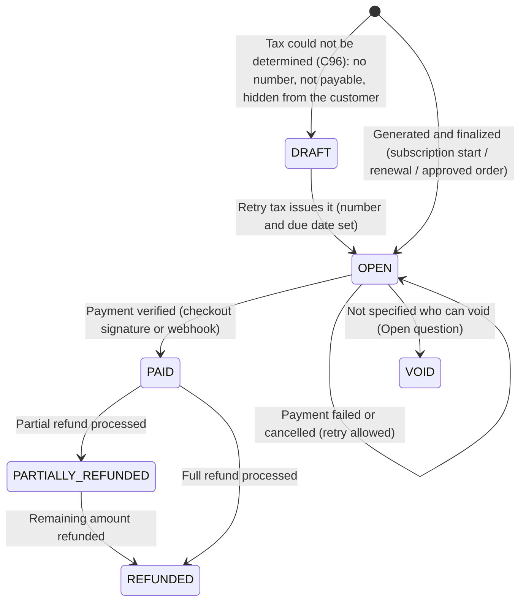
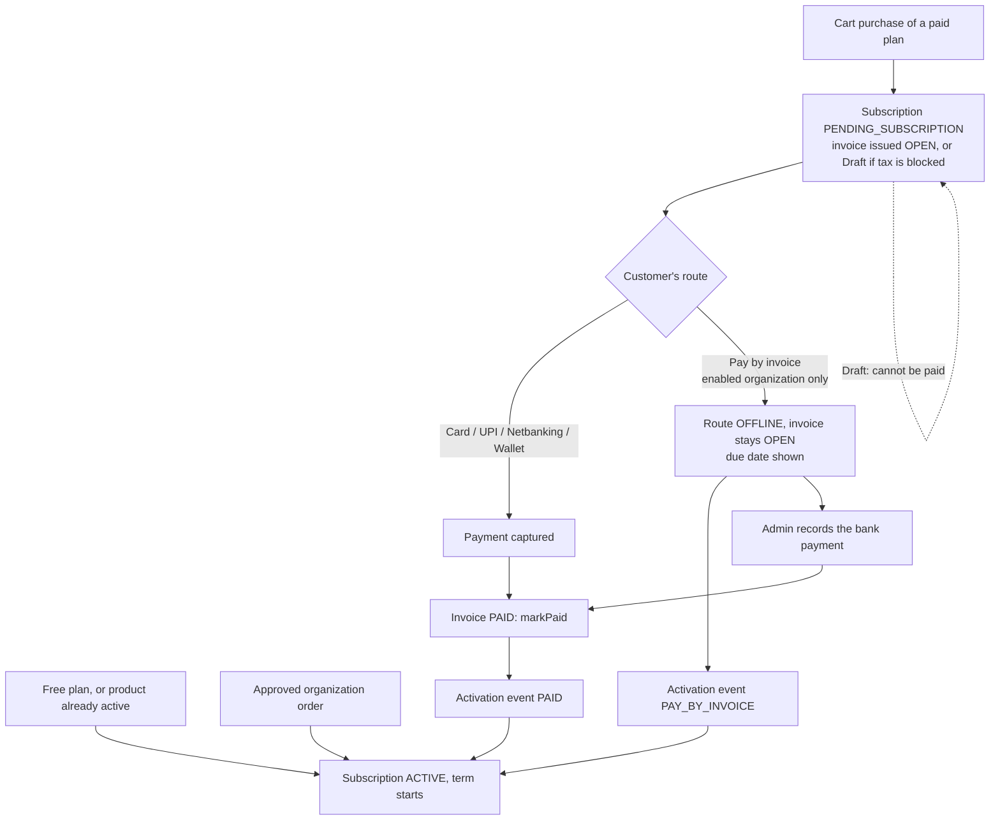
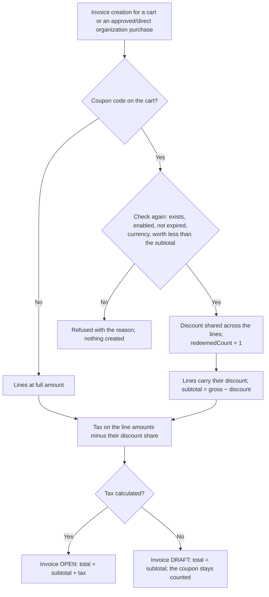
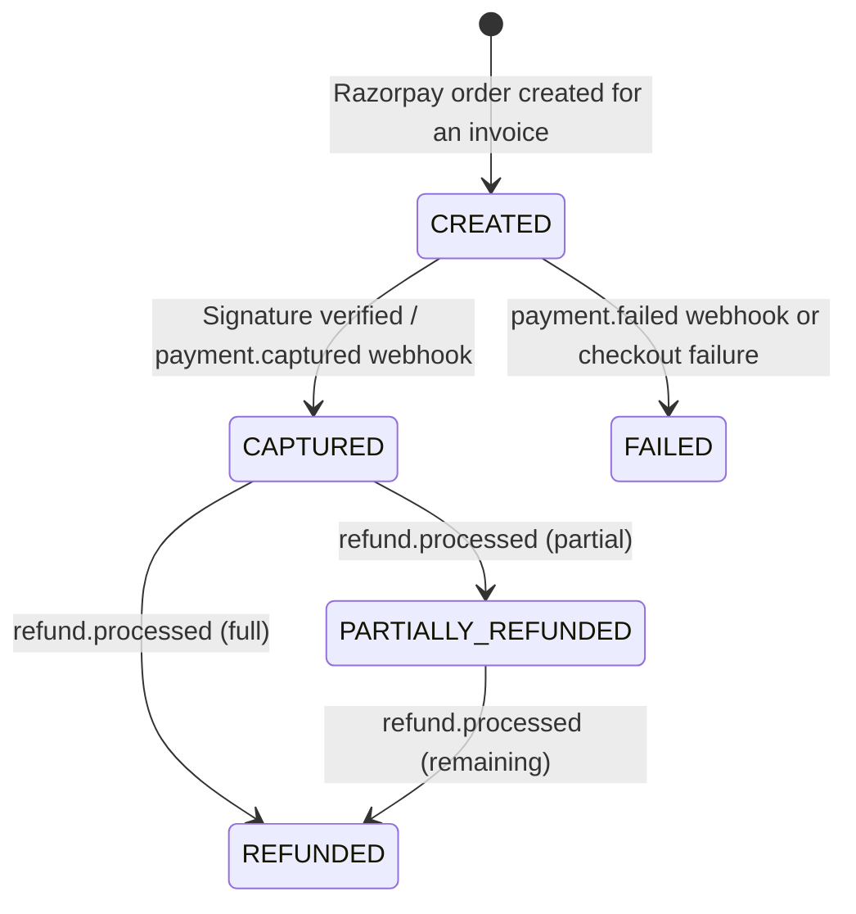

# Workflow — Billing & Payments (REQ-BIL-001)

The end-to-end flow across subscriptions, orders and billing is in [docs/04-workflows/purchase-to-payment.md](../../../04-workflows/purchase-to-payment.md). This file covers the states inside this feature.

## Invoice states

Payment reminders (BR-17) go out while an invoice is OPEN; they stop at PAID or REFUNDED.

`VOID` is listed because an unpaid invoice must be cancellable in some way; who may void and when is **Not specified**.

## When a purchase starts ([C97](../../../01-business/roadmap/open-decisions.md#c97) BI-1)

A second activation event for a subscription that is already ACTIVE does nothing (BR-14).

## Invoice with a coupon ([C100](../../../01-business/roadmap/open-decisions.md#c100), REQ-BIL-001.35)

A seat-increase invoice and a renewal invoice never take a coupon.

## Payment states

Authorize and capture happen together (Razorpay auto-capture). Separate authorize-then-capture is Not specified.

## Payment method states
`ACTIVE` (saved token usable) → `REMOVED` (customer removed it; token deleted at Razorpay). Card expiry is shown; expired cards are marked **Expired** and cannot be set as default.

## Actors
| Step | Actor |
|---|---|
| Edit billing details, pay, add/remove payment methods | Customer, or an organization member with Manage billing (BR-19) |
| Add a purchase-order number | The invoice's owner, until it is paid (BR-22) |
| Refund, reconcile, view all, choose the active gateway, enable Pay by invoice for an organization, create, edit, disable and delete coupons | Platform admin (`MANAGE_BILLING`) |
| Send payment reminders | The invoice reminder job (every 30 minutes), BR-17 |
| Payment confirmation | Razorpay (checkout result + webhook) |
