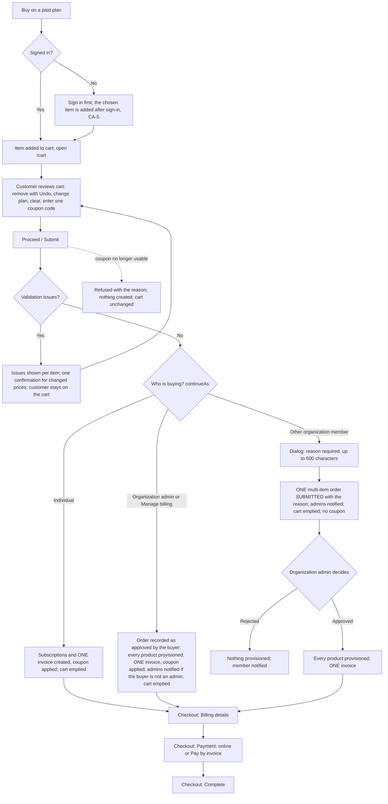

# Workflow — Cart and checkout (REQ-MKT-003)

The flow across features (cart → subscription or order → invoice → payment) is in [docs/04-workflows/purchase-to-payment.md](../../../04-workflows/purchase-to-payment.md).

## Flow

## Cart item states
A cart item has no stored status. Its validation result is calculated when the customer continues, and again when the checkout is created.

| Result | Meaning | Customer action |
|---|---|---|
| OK | No issue | — |
| `NOT_AVAILABLE` | The product is no longer published, or the plan was removed | Remove the item, or change the plan |
| `PRICE_CHANGED` | The price differs from the price when the item was added | **Confirm new prices** once for the whole cart, or remove the item |
| `ALREADY_SUBSCRIBED` | An ACTIVE subscription to the product exists | Remove the item |
| `MISSING_DEPENDENCY` | A required product is neither owned nor in the cart | Add the required product, or remove the item |
| `CURRENCY_MISMATCH` | The item's currency differs from the first item's | Check out separately, or remove the item |
| `NOT_ELIGIBLE` | The product is not offered to this kind of account (REQ-CAT-005) | Remove the item |

## Transitions
| From | To | Actor | Condition / rule | Side effects |
|---|---|---|---|---|
| (none) | Item in cart | Customer | Paid plan; BR-2, BR-3 | Toast; cart badge count updates |
| Item in cart | Removed | Customer | — | Toast with Undo for about 5 s; Undo restores the item |
| Cart | Coupon applied | Individual, organization buyer | Not a purchase request; code usable (BR-18) | Discount line and net total in the cart; nothing is counted yet |
| Cart | Checkout created (individual) | Customer | No issues (BR-6, BR-7); coupon still usable (BR-19) | Subscriptions and one invoice created; coupon counted; cart emptied; invoice audited (REQ-BIL-001.17) |
| Cart | Direct purchase (organization) | Organization admin or Manage billing | No issues; BR-14 | Order recorded as approved by the buyer; every product provisioned; one invoice; admins notified when the buyer is not an admin; cart emptied; audited |
| Cart | Purchase request submitted | Organization member | No issues; reason given (BR-15) | One multi-item order (REQ-ORD-001) with the reason; admins notified; cart emptied; audited |
| Purchase request | Approved → invoice issued | Organization admin | REQ-ORD-001 | Every product provisioned; one invoice; the requester is notified |
