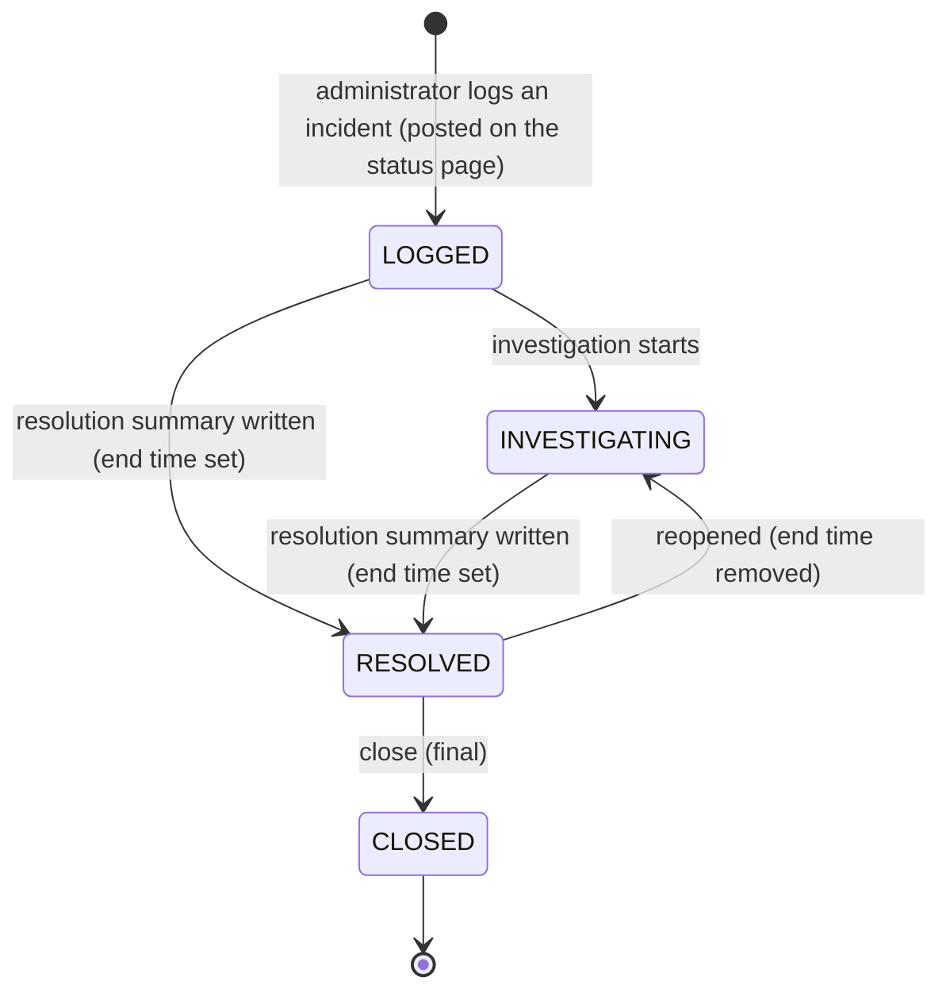
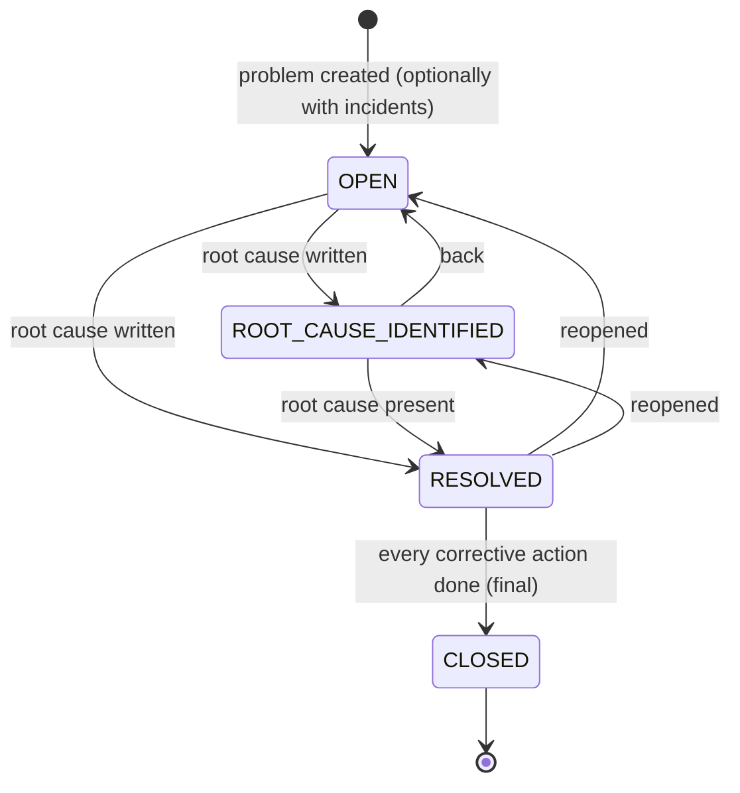

# Workflow — Incident and problem management (REQ-SUP-003)

## Incident phases

Logged and Investigating incidents have **no end time** and show as open on the status page; Resolved and Closed incidents show as resolved. A closed incident cannot be changed in any way.

## Problem statuses


## From a customer's trouble to a corrective action
```mermaid
sequenceDiagram
    autonumber
    participant C as Customers
    participant T as Support tickets
    participant A as Platform administrator
    participant I as Incident (service_incident)
    participant SP as Status page
    participant P as Problem

    C->>T: report the same trouble (tickets)
    A->>I: log incident (public: title, message, product, start; internal: severity, notes, assignee)
    I-->>SP: public fields only, to customers who bought the product
    A->>I: link the tickets
    A->>I: investigate (phase, notes)
    A->>I: resolve (resolution summary, end time)
    A->>I: close
    A->>P: create problem and link the incidents (an incident in one problem only)
    A->>P: write the root cause, move to Root cause identified
    A->>P: add corrective actions (owner, due date), mark them done
    A->>P: resolve, then close (every action done)
```

## Transitions
| From | To | Actor | Condition / rule | Side effects |
|---|---|---|---|---|
| (new) | LOGGED | Administrator | BR-INC-003 | Audit `INCIDENT_POSTED`; visible on the status page to purchasers; business-dashboard alert while open |
| LOGGED / INVESTIGATING | RESOLVED | Administrator | Resolution summary; BR-INC-004 | End time set; audit `INCIDENT_UPDATED` |
| RESOLVED | INVESTIGATING | Administrator | End time removed; BR-INC-005 | End time cleared |
| RESOLVED | CLOSED | Administrator | BR-INC-004 | Closing time stored; incident final |
| (new) | OPEN (problem) | Administrator | Title; BR-INC-010 | Audit `PROBLEM_CREATED`; incidents linked |
| OPEN / ROOT_CAUSE_IDENTIFIED | RESOLVED (problem) | Administrator | Root cause; BR-INC-012 | Resolved time stored |
| RESOLVED | CLOSED (problem) | Administrator | Every action done; BR-INC-012 | Closing time stored; problem final |
