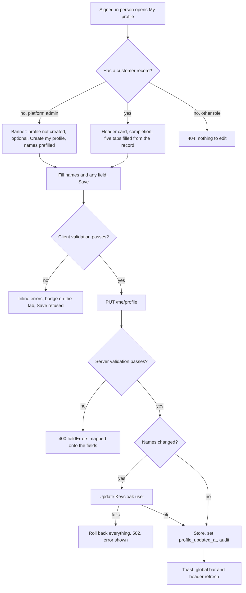

# Workflow — My profile

## Photo
Choose a file → the browser checks type and size and shrinks it to 512 x 512 → `PUT /me/profile/photo` → the server checks type, first bytes, size and dimensions → stored, audited `PROFILE_PHOTO_UPDATED` → the avatar and the bar refresh. Remove → `DELETE /me/profile/photo` → `PROFILE_PHOTO_REMOVED` → initials return.

## Global bar
Sign in → `GET /me/profile/completion` → the bar shows when `exists` and `percent` below 100 and the page is not `/account/profile` → *Complete profile* opens the page, the dismiss control hides it for the session → a save or photo change reloads the figure.

## Platform administrator edits a customer
Organization detail (members) or the individuals list → *Edit profile* dialog → `GET /admin/registrations/individuals/{customerId}/profile` → edit the four sections (no photo) → `PUT` (same validation, Keycloak mirroring, audit `PROFILE_UPDATED_BY_ADMIN`).
