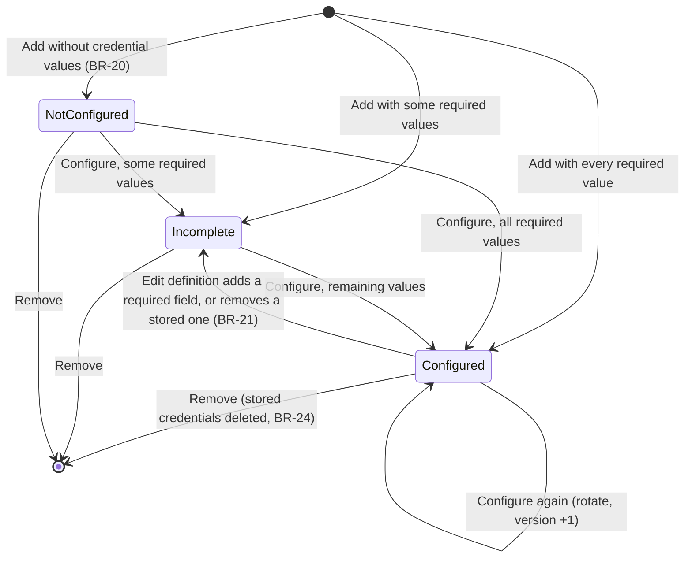
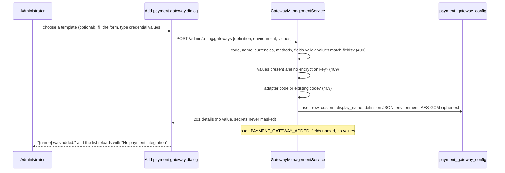
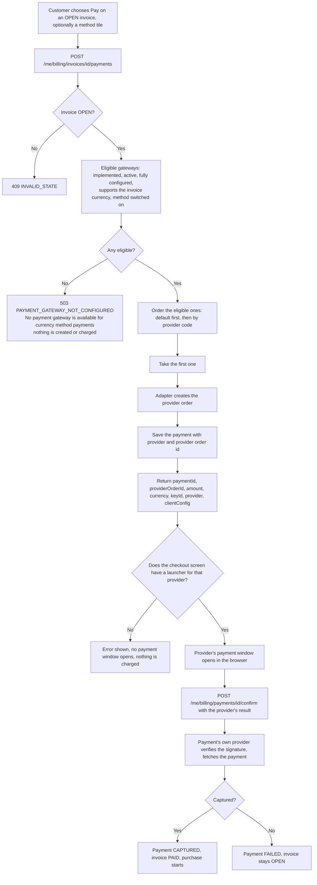
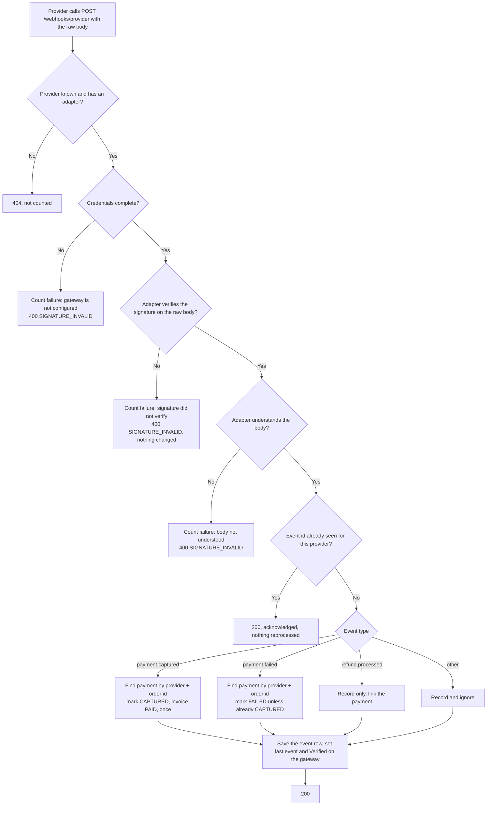

# Workflow — Payment gateways (REQ-BIL-003)

Rule numbers (BR-n) refer to [business-rules.md](business-rules.md). Two kinds of gateway exist: a **built-in provider** with an adapter (Razorpay), which follows the set-up flow below, and a **gateway added by an administrator** (no adapter, configuration only), which follows [Adding, editing and removing a gateway](#adding-editing-and-removing-a-gateway-c99) and never reaches Test, Activate, Default or routing.

## Gateway set-up: configure → test → activate (built-in providers)
Configured, Connected, Active and Default are four separate facts (BR-6). The gateway moves through them independently:

```mermaid
stateDiagram-v2
    [*] --> NotConfigured: provider has an adapter
    NotConfigured --> Incomplete: some required fields saved
    NotConfigured --> Configured: all required fields saved
    Incomplete --> Configured: remaining fields saved
    Configured --> Configured: save again (version +1, Connected becomes Not tested)
    Configured --> Tested: Test connection passes
    Configured --> TestFailed: Test connection fails (real status shown)
    TestFailed --> Configured: fix credentials and save
    Tested --> Active: Activate (a fresh test passes inside the request)
    Configured --> Active: Activate (a fresh test passes inside the request)
    Active --> Default: Make default (first activated gateway becomes default)
    Active --> Active: rotate credentials (tested first, old kept on failure, BR-9)
    Default --> Active: another gateway made default
    Active --> Configured: Deactivate (also clears Default)
    Default --> Configured: Deactivate
```

| Step | Actor | Rule | What happens |
|---|---|---|---|
| Configure | Administrator (`MANAGE_BILLING`) | BR-3, BR-4, BR-5, BR-14 | Enters the environment and the credentials the provider's field list asks for; a blank field keeps the stored value. Refused if a value is entered and the server has no encryption key. Version +1. |
| Test connection | Administrator | BR-7 | Real call to the provider; the outcome and the configuration version tested are stored. No call when the configuration is empty or incomplete. |
| Activate | Administrator | BR-8 | Needs a complete configuration; tests again inside the request; only a passing test activates. |
| Make default | Administrator | BR-8 | Only an active gateway; the previous default is cleared. |
| Deactivate | Administrator | BR-8 | Always allowed; clears Default; existing payments are untouched. |
| Switch off a payment method | Administrator | BR-15 | At least one method stays on. |
| Rotate | Administrator | BR-9 | Active gateway: new credentials tested first; on failure nothing is saved. |

## Adding, editing and removing a gateway (C99)
An administrator-added gateway has no adapter (BR-23): it can be configured, edited and removed and nothing else. Its configuration status comes from its credentials; it is never tested, active or default.



| Step | Actor | Rule | What happens |
|---|---|---|---|
| Open the form | Administrator (`MANAGE_BILLING`) | BR-25 | **Add payment gateway** opens the dialog. The templates (`GET /admin/billing/gateways/templates`) fill the **Start from** list; choosing one pre-fills name, code, description, currencies, countries, methods and credential fields (never values) |
| Fill in | Administrator | BR-20 | Name, code (derived from the name until typed), description, environment, currencies, countries, methods, credential fields (label, name derived from the label, secret, required) and optional values. **Add gateway** stays disabled and the first problem is named until the form is valid |
| Add | Administrator | BR-20 to BR-22 | `POST /admin/billing/gateways`: validated, encrypted values stored with the definition in one transaction, audit `PAYMENT_GATEWAY_ADDED`. A refusal (400, 409 duplicate code, 409 no encryption key) shows inside the dialog and nothing is saved |
| Enter or rotate values | Administrator | BR-22 | **Configure** (`PUT …/{code}/configuration`): only typed fields are sent, a blank keeps the stored value, no test is run |
| Edit definition | Administrator | BR-21 | **Edit** opens the same form with the code locked and no environment or value inputs (existing credential names are locked too); `PUT …/{code}/definition`; stored values of removed fields are dropped; audit `PAYMENT_GATEWAY_DEFINITION_CHANGED` |
| Remove | Administrator | BR-24 | **Remove** asks "Remove {name}?"; `DELETE …/{code}` deletes the row and its stored credentials; audit `PAYMENT_GATEWAY_REMOVED` |
| Try Test, Activate, Default, Methods | Anyone calling the API | BR-23 | Refused with 409; the screen shows no such buttons |



### Saving an active gateway (rotation)
```mermaid
sequenceDiagram
    participant A as Administrator
    participant UI as Configure dialog
    participant S as GatewayManagementService
    participant P as Provider
    A->>UI: type the new secret, Save
    UI->>S: PUT /admin/billing/gateways/{code}/configuration (only typed fields)
    S->>S: key present? fields valid? environment valid? (400 / 409)
    S->>S: begin transaction, merge with stored values, save, version + 1
    S->>P: test connection with the new configuration
    alt test passes
        P-->>S: ok
        S->>S: commit configuration and passing result together
        S-->>UI: details (200); audit PAYMENT_GATEWAY_CONFIGURED
    else test fails
        P-->>S: refused or unavailable
        S->>S: roll back, old credentials and version stay
        S-->>UI: 409 "Not saved: ... The previous configuration is unchanged."
        Note over S: audit PAYMENT_GATEWAY_CONFIGURATION_REJECTED, no values
    end
```

## Payment routing
The browser never chooses a gateway (BR-10). A payment keeps the provider that created it (BR-11).



After creation, confirm, reconcile and refund use `payment.provider`; deactivating that gateway or changing the default does not move the payment to another provider. There is no fail-over: if the chosen provider errors, the customer sees the error and may try again (the next attempt is routed afresh).

## Webhook handling


A gateway added by an administrator has no adapter, so it is answered 404 at the first step (BR-23). A deactivated provider still passes step C and D as long as its credentials are complete, so payments already in flight finish (BR-13). Failures update one counter and the latest reason on the gateway row; they never add a row per attempt.

## Provider failure handling
| Situation | What EIS records | What the user sees |
|---|---|---|
| Provider unreachable or 5xx during a test | Connection status `PROVIDER_UNAVAILABLE` | "Provider unavailable", not "Authentication failed" |
| Provider rejects the credentials (401/403) | `AUTHENTICATION_FAILED` | Gateway stays inactive (or, if active, a rotation is not saved) |
| Order creation fails at checkout | Nothing: no payment row is saved for a failed order creation (the request is rolled back) | The provider's error as 502 `PAYMENT_GATEWAY_ERROR` (Razorpay); nothing is charged |
| Forged or unsigned webhook | Failure counter + reason only | Details show "n rejected webhook(s)" and the last reason |
| Duplicate webhook | Nothing | Nothing |

## Roles
| Step | Actor |
|---|---|
| Add, edit, remove, configure, test, activate, deactivate, default, methods | Platform administrator with `MANAGE_BILLING` (an added gateway allows only add, edit, remove and configure) |
| Pay an invoice | Customer, or organization billing user |
| Webhook | The payment provider, authenticated only by its signature |
