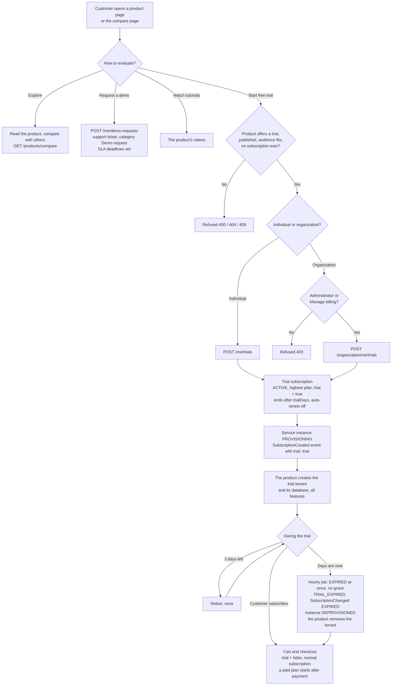
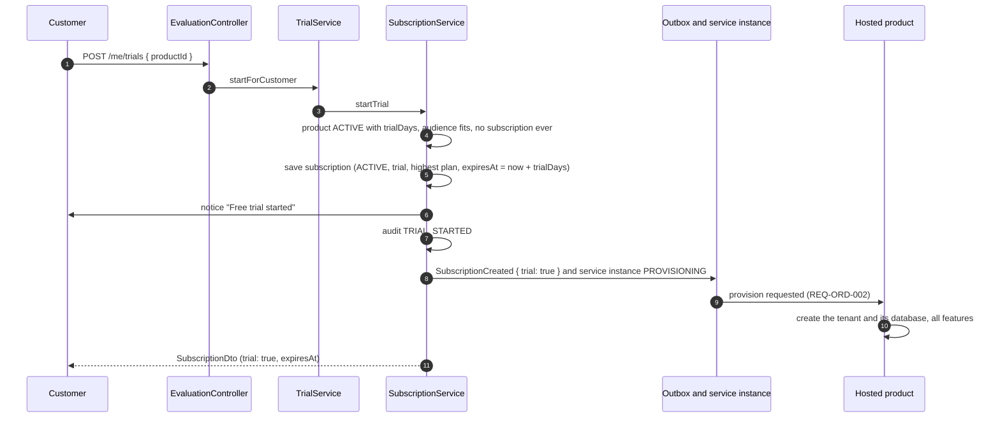
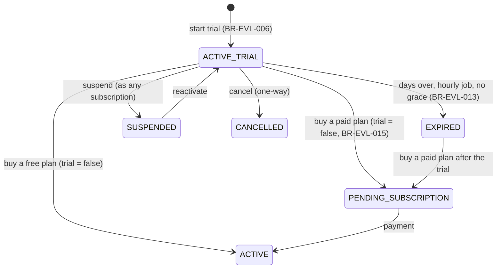
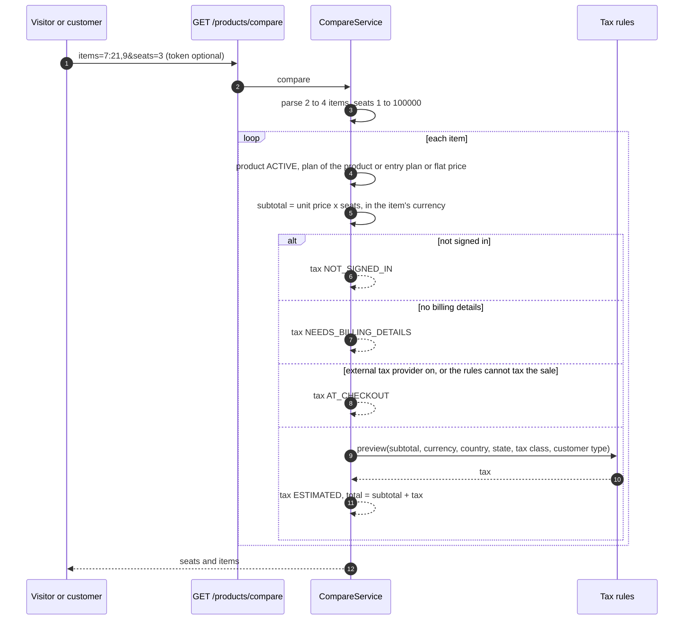
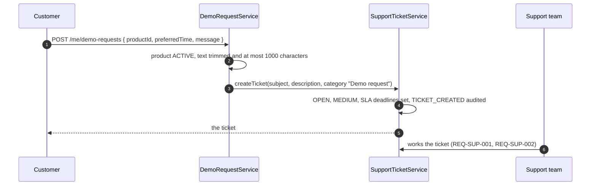

# Workflow — Product evaluation (REQ-MKT-005)

## From exploring to buying

Buying while the trial is still running is refused by the cart today (`ALREADY_SUBSCRIBED`, [BR-EVL-016](business-rules.md)); after the trial has ended it works. The service-level purchase turns a running trial into a normal subscription ([BR-EVL-015](business-rules.md)).

## Starting a trial

For an organization the call is `POST /organization/me/trials`; `TrialService#startForOrganization` first checks the caller is an administrator or holds Manage billing, then `SubscriptionService#startOrganizationTrial` creates the trial with the organization's seats and refreshes member product access. No notice is sent for an organization-owned subscription.

## State of a trial subscription

`ACTIVE_TRIAL` is `ACTIVE` with `trial = true`. A trial has no grace period, so it never shows the read-only state of [REQ-SUB-004](../renewal-reminders/requirement.md). It cannot be renewed, set to auto-renew or moved to another plan ([BR-EVL-009](business-rules.md)).

## Compare

## Demo request

## Transitions
| From | To | Actor | Condition / rule | Side effects |
|---|---|---|---|---|
| (no subscription) | trial ACTIVE | Customer, or organization administrator / Manage billing | BR-EVL-003 to BR-EVL-007 | Notice (individual); `TRIAL_STARTED`; `SubscriptionCreated` with `trial: true`; service instance PROVISIONING; member access refreshed (organization) |
| trial ACTIVE | (reminded) | System, hourly | Ends within 3 days, not reminded; BR-EVL-011 | Notice once; `trial_reminded_at` set |
| trial ACTIVE | EXPIRED | System, hourly | `expiresAt` passed; BR-EVL-013 | Notice (individual); `TRIAL_EXPIRED`; `SubscriptionChanged` EXPIRED; instance DEPROVISIONED; member access refreshed (organization) |
| trial ACTIVE or EXPIRED | normal subscription | Customer buys | BR-EVL-015 (cart: BR-EVL-016) | `trial` = false; plan, renewal date and auto-renew of the purchase; paid plan PENDING_SUBSCRIPTION until paid |
| (any) | demo ticket OPEN | Customer | BR-EVL-018 | Ticket in category "Demo request" with SLA deadlines; `TICKET_CREATED` |
| (any) | (nothing) | Anyone | Compare, BR-EVL-021 | Read-only |
