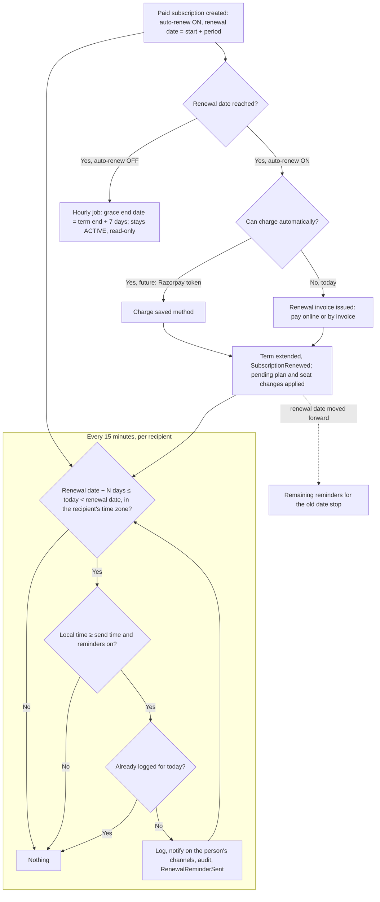
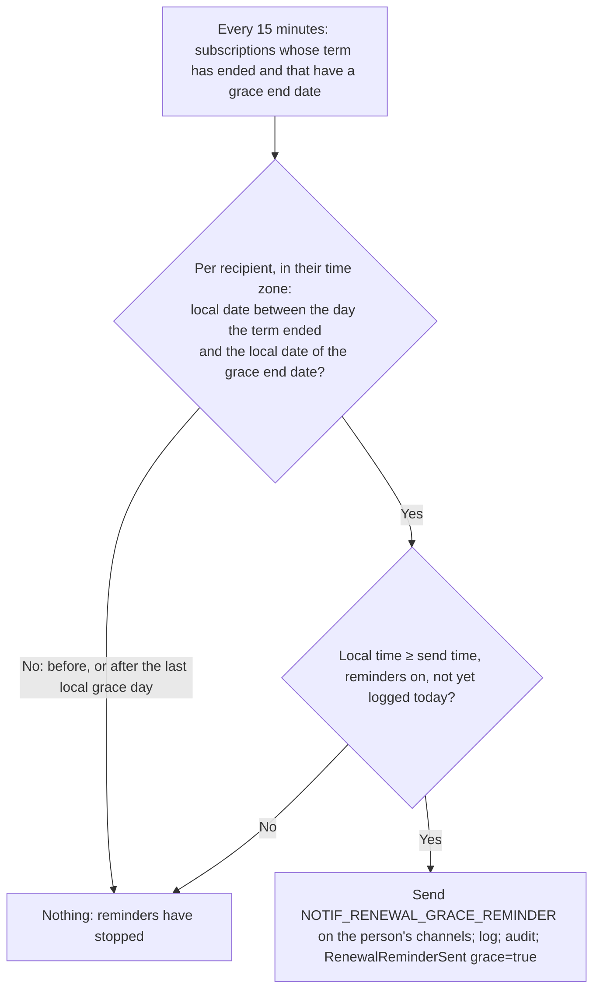
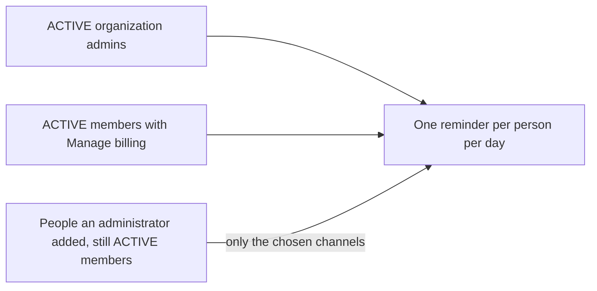

# Workflow — Auto-renewal and renewal reminders (REQ-SUB-004)

## Grace period (C100 RR-1 B, RR-4 A)

```mermaid
stateDiagram-v2
    [*] --> ACTIVE
    ACTIVE --> ACTIVE_READ_ONLY: term ended, auto-renew OFF (expiry job sets the grace end date, term end + 7 days)
    ACTIVE_READ_ONLY --> ACTIVE: renewed, or auto-renew turned ON (renews at once); grace end date cleared
    ACTIVE_READ_ONLY --> EXPIRED: grace end date passed (expiry job)
    EXPIRED --> ACTIVE: individual Renew
```

`ACTIVE_READ_ONLY` is not a stored status: the subscription is ACTIVE with a grace end date in the future and a term end in the past. The entitlement check answers `allowed` with `accessMode = READ_ONLY` ([REQ-SUB-002.10](../entitlements/requirement.md)).

The last reminder is on the **last local grace day**, which can be after the grace instant and after the subscription has become EXPIRED.

## Who is reminded (organization subscription)

An administrator with Manage billing edits the added list on My subscriptions; defaults are shown read-only.
