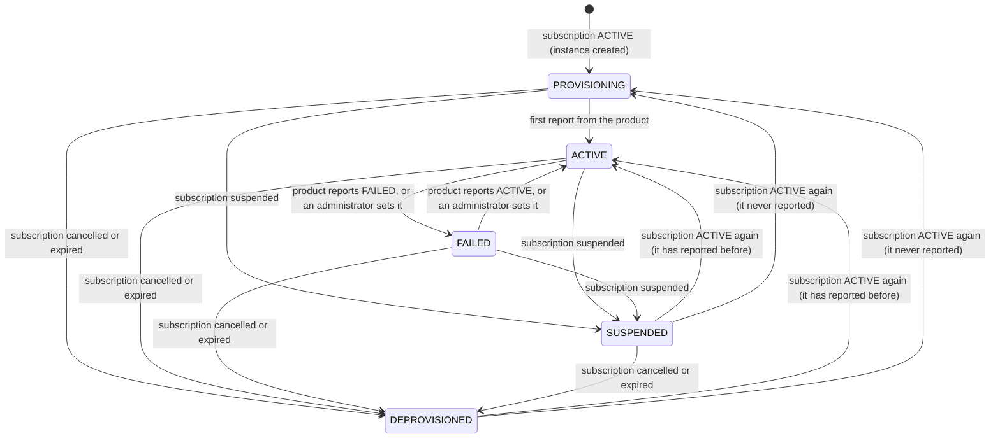
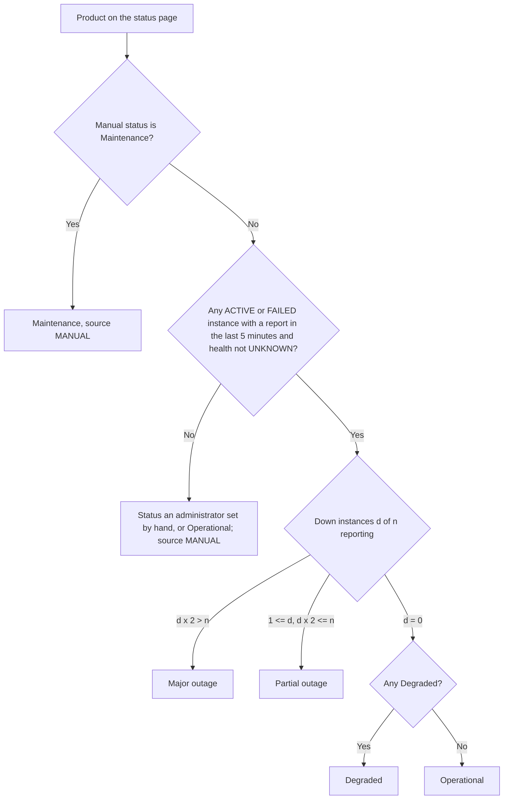

# Workflow — Service instances (REQ-SRM-001)

## From subscription to the status page
```mermaid
sequenceDiagram
    autonumber
    participant C as Customer / organization
    participant S as Subscription flow
    participant I as Service instance (EIS)
    participant A as Platform administrator
    participant P as Hosted product
    participant SP as Status page

    C->>S: subscription becomes ACTIVE
    S->>I: create instance (PROVISIONING, health UNKNOWN)
    A->>I: create reporter key for the product (shown once)
    A-->>P: hands over the key (outside EIS)
    loop about every minute
        P->>I: POST /product-reports/health  (X-Reporter-Key)
        I->>I: check key, product, health value
        I-->>P: accepted / rejected per report
        Note over I: first report: PROVISIONING -> ACTIVE
    end
    SP->>I: product status? (instances that reported in the last 5 minutes)
    I-->>SP: Operational / Degraded / Partial / Major outage, with the counts
    Note over SP: a manual Maintenance wins; no recent report keeps the manual status
    A->>I: product cannot report: set status/health by hand with a note (audited)
```

## Instance status

An administrator can set any status by hand (BR-SRM-009); that is not drawn.

## Health on the status page


## Transitions
| From | To | Actor | Condition / rule | Side effects |
|---|---|---|---|---|
| (none) | PROVISIONING | Subscription flow | Subscription is ACTIVE; BR-SRM-001 | Recorded as `SYSTEM`; none audited |
| PROVISIONING | ACTIVE | Product | First accepted report; BR-SRM-007 | Health and time of report stored; `PRODUCT` |
| any | SUSPENDED / DEPROVISIONED | Subscription flow, reconcile job | BR-SRM-002 | `SYSTEM` |
| SUSPENDED / DEPROVISIONED | PROVISIONING / ACTIVE | Subscription flow, reconcile job | Subscription ACTIVE again; BR-SRM-002 | `SYSTEM` |
| any | any | Platform administrator | Note required; BR-SRM-009 | Audit `SERVICE_INSTANCE_CHANGED`; `ADMIN` |
| ACTIVE / PROVISIONING | FAILED, ACTIVE | Product | Status in the report; BR-SRM-006 | `PRODUCT` |
