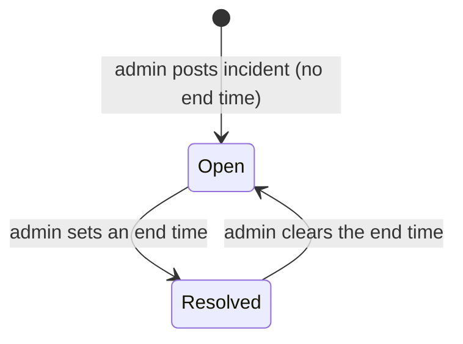
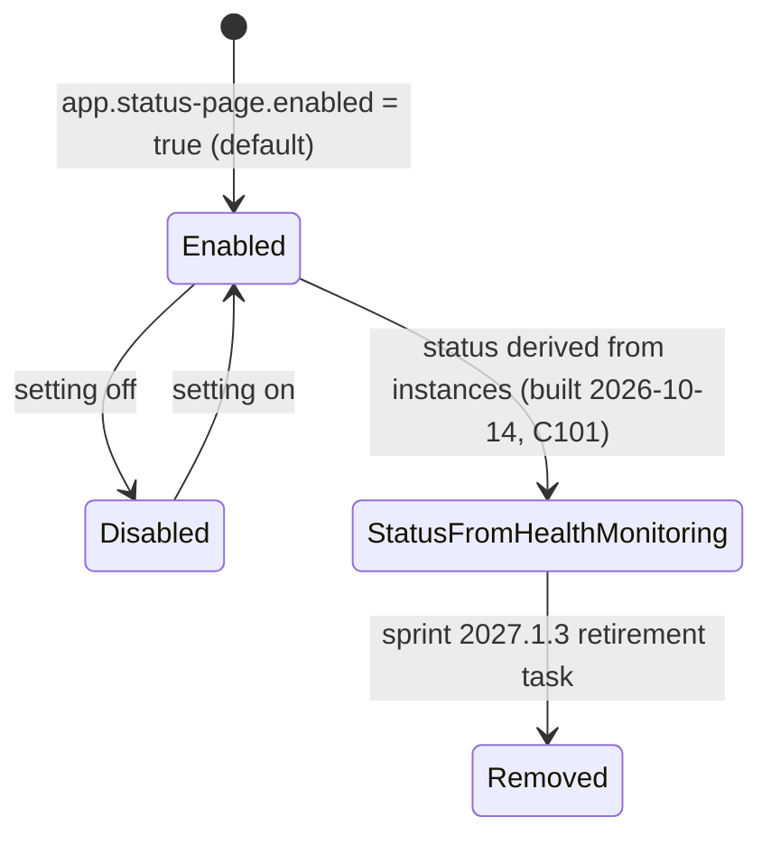

# Workflow — Interim Service Status Page

## Incident

## Incident (from C101)
Since 2026-10-14 an incident has the phases Logged, Investigating, Resolved and Closed ([REQ-SUP-003 workflow](../incident-problem-management/workflow.md)). The customer view still distinguishes only open (no end time) from resolved.

## Product status (from C101)
A product's status is derived from its instances' health, with a manual Maintenance winning and the manual status kept when no instance reported recently ([REQ-SRM-001 workflow](../service-instances/workflow.md#health-on-the-status-page)).

## Page lifecycle

## Transitions
| From | To | Actor | Condition / rule | Side effects |
|---|---|---|---|---|
| — | Open | Platform admin | `MANAGE_SERVICE_STATUS`; active product | Audit `INCIDENT_POSTED`; dashboard alert for purchasers |
| Open | Resolved | Platform admin | End time not before start | Audit `INCIDENT_UPDATED` |
| Enabled | Disabled | Operator (configuration) | Setting off | Customer view returns `enabled: false` |
