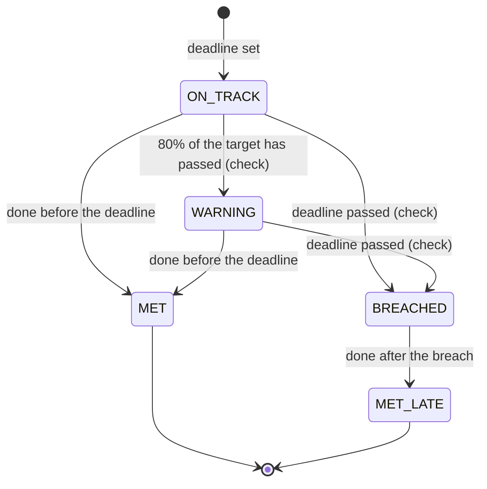
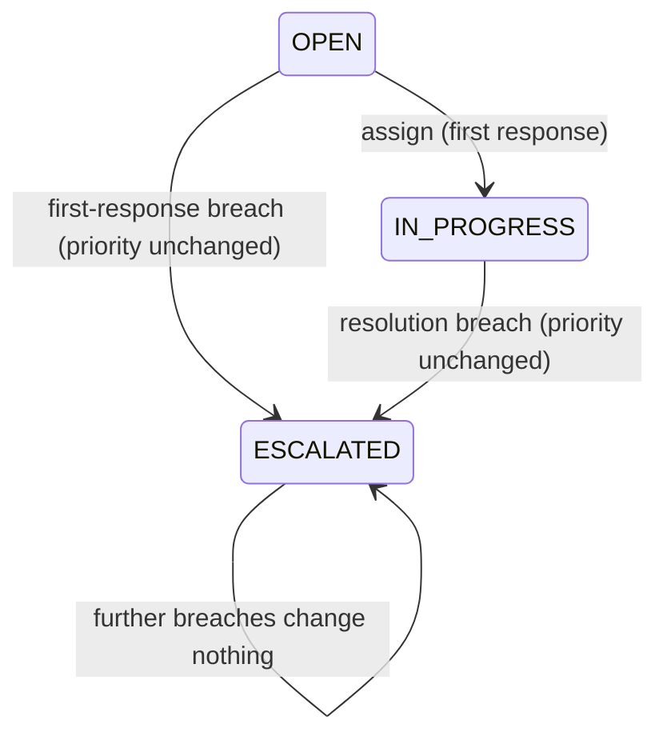

# Workflow — SLA management (REQ-SUP-002)

## A ticket against its SLA
```mermaid
sequenceDiagram
    autonumber
    participant C as Customer
    participant T as Ticket (REQ-SUP-001)
    participant S as SLA check (every minute)
    participant P as Assignee and alert list
    participant A as Support administrator

    C->>T: create ticket (OPEN, MEDIUM)
    T->>T: set first-response and resolution deadlines from the creation time
    Note over T: clock starts, never pauses
    A->>T: change priority (or escalate)
    T->>T: recalculate both deadlines from the creation time
    loop every minute
        S->>T: tickets not RESOLVED or CLOSED with deadlines
        alt 80% of a target has passed
            S->>P: warning (in-app and email), once per target
        else deadline passed
            S->>T: status ESCALATED, priority unchanged, breach flagged
            S->>P: breach alert, once per target
        end
    end
    A->>T: assign / escalate / resolve (first one = first response)
    T->>T: first response stored; resolve stops the resolution clock
```

## State of one target

A ticket created before SLA tracking has no deadline and so no state at all (BR-SLA-017). The state is computed when the ticket is read (BR-SLA-013); `WARNING` and `BREACHED` are stored as marks by the check. A breach stays on record even if the deadline is later moved by a priority change.

## Ticket status effects

RESOLVED and CLOSED tickets are not watched. The other transitions of a ticket are in [ticket-management workflow](../ticket-management/workflow.md).

## Transitions
| From | To | Actor | Condition / rule | Side effects |
|---|---|---|---|---|
| (new ticket) | deadlines set | System | BR-SLA-005 | None |
| any open ticket | deadlines moved | Administrator | Priority changed or ticket escalated; BR-SLA-008 | Warning marks cleared |
| ON_TRACK | WARNING | System (check) | 80% of the target passed; BR-SLA-009 | In-app notice and email to assignee and alert list; audit `TICKET_SLA_WARNING` |
| ON_TRACK / WARNING | BREACHED | System (check) | Deadline passed; BR-SLA-010 | Ticket ESCALATED (priority unchanged); alert as above with severity CRITICAL; audit `TICKET_SLA_BREACHED` |
| OPEN | first response stored | Administrator | Assign, escalate or resolve; BR-SLA-006 | `first_responded_at` set once |
| open | resolved | Administrator | BR-SLA-007 | Resolution clock stops; ticket no longer watched |
| settings | saved | Administrator | `MANAGE_SUPPORT_TICKETS`; BR-SLA-015 | Audit; existing tickets untouched (BR-SLA-016) |
