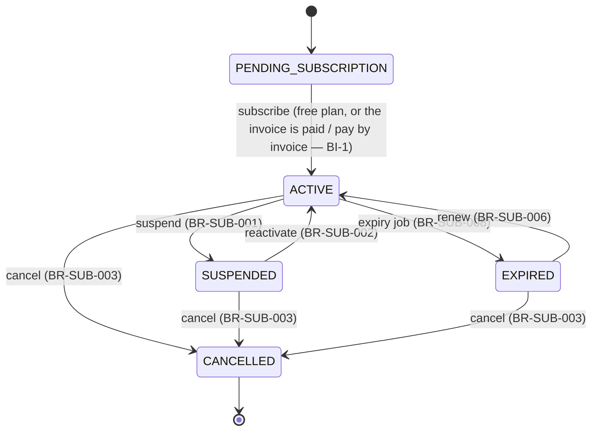
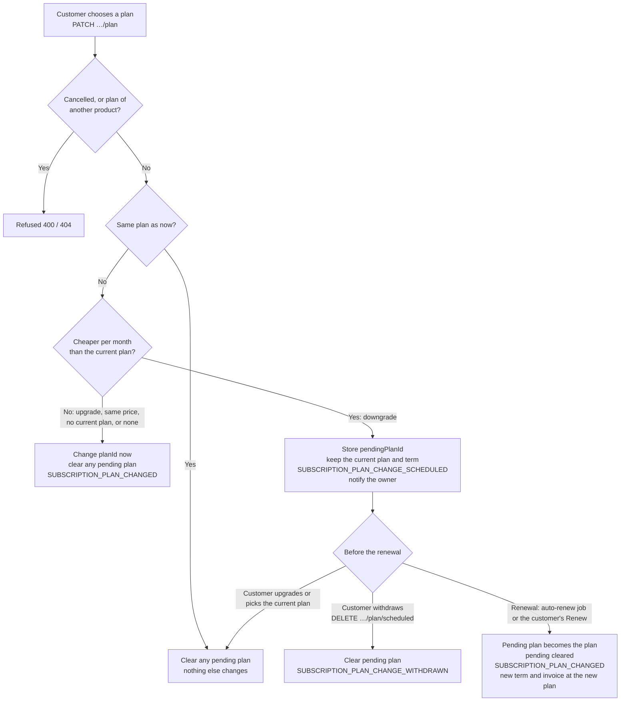

# Workflow — Subscription Lifecycle

## States

A **free trial** ([BR-SUB-014](business-rules.md), [REQ-MKT-005](../product-evaluation/workflow.md)) is an ACTIVE subscription with `trial` = true that goes **straight to EXPIRED** at its end, with no grace period; buying turns it into a normal subscription (`trial` = false) in place.

Change plan (BR-SUB-007) does not move between these states — it only changes `planId`, on any status except CANCELLED. A downgrade does not even change `planId` until the next renewal (see below).

## Scheduled plan change ([C97](../../../01-business/roadmap/open-decisions.md#c97) SC-1)

## Transitions
| From | To | Actor | Condition / rule | Side effects (notifications, audit) |
|------|----|-------|------------------|-------------------------------------|
| ACTIVE | SUSPENDED | Customer | BR-SUB-001 | `SUBSCRIPTION_SUSPENDED` audit; notification |
| SUSPENDED | ACTIVE | Customer | BR-SUB-002 | `SUBSCRIPTION_REACTIVATED` audit; notification |
| ACTIVE / SUSPENDED / EXPIRED / PENDING_SUBSCRIPTION | CANCELLED | Customer | BR-SUB-003 | `SUBSCRIPTION_CANCELLED` audit; notification |
| ACTIVE | EXPIRED | Scheduled job | BR-SUB-008 (`expiresAt` passed) | `SUBSCRIPTION_EXPIRED` audit; notification |
| Any non-CANCELLED | (same status, `expiresAt` extended) | Customer | BR-SUB-005 | `SUBSCRIPTION_RENEWED` audit; notification |
| EXPIRED | ACTIVE | Customer (via renew) | BR-SUB-006 | `SUBSCRIPTION_RENEWED` audit; notification |
| Any non-CANCELLED | (same status, `planId` changed) | Customer | BR-SUB-007 (upgrade, immediate) | `SUBSCRIPTION_PLAN_CHANGED` audit |
| Any non-CANCELLED | (same status, `pendingPlanId` set) | Customer | BR-SUB-011 (downgrade) | `SUBSCRIPTION_PLAN_CHANGE_SCHEDULED` audit; notification; `SubscriptionChanged` event |
| Any non-CANCELLED | (same status, `pendingPlanId` cleared) | Customer | BR-SUB-013 (withdraw) | `SUBSCRIPTION_PLAN_CHANGE_WITHDRAWN` audit |
| ACTIVE / EXPIRED | (term extended, `planId` = pending plan) | Auto-renew job, or the customer's Renew | BR-SUB-012 | `SUBSCRIPTION_PLAN_CHANGED` audit, then the renewal's own audit and invoice |
| ACTIVE (trial) | EXPIRED | Scheduled job | BR-SUB-014 (`expiresAt` passed; no grace) | `TRIAL_EXPIRED` audit; notification (individual); `SubscriptionChanged` event; instance deprovisioned |
| ACTIVE (trial) or EXPIRED | normal subscription | Customer buys | BR-SUB-014 | `trial` = false; the purchase's own audit, invoice and, for a paid plan, PENDING_SUBSCRIPTION until paid |
