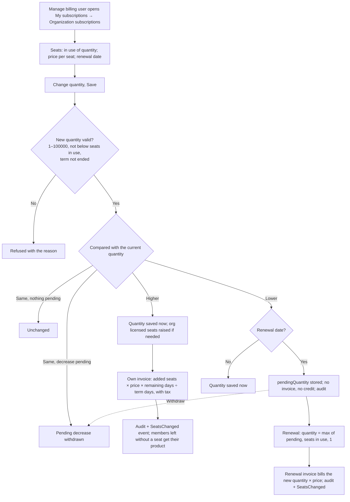

# Workflow — Seats and quantity (REQ-SUB-003)

## States of a subscription's seats
| State | Meaning |
|---|---|
| Quantity only | No change scheduled |
| Quantity and pending quantity | A decrease will apply at the renewal date; the screen shows "Falls to {n} seats on {date}. Nothing is credited." and **Withdraw** |
