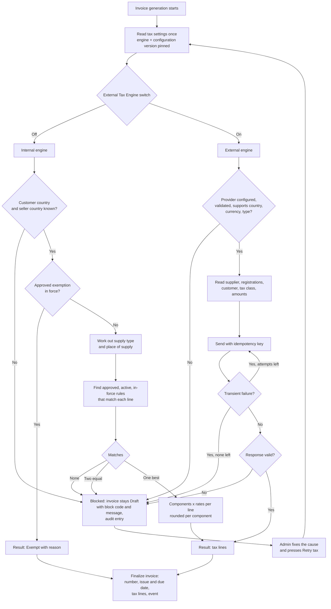
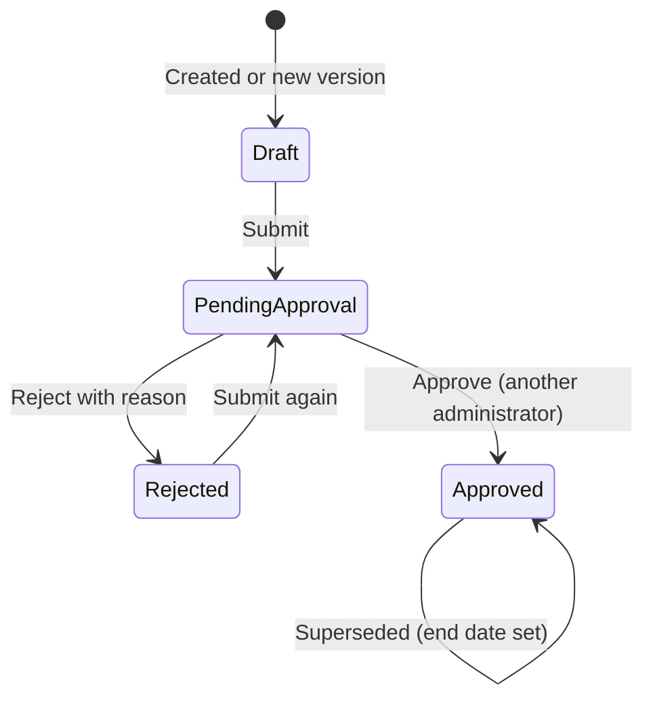
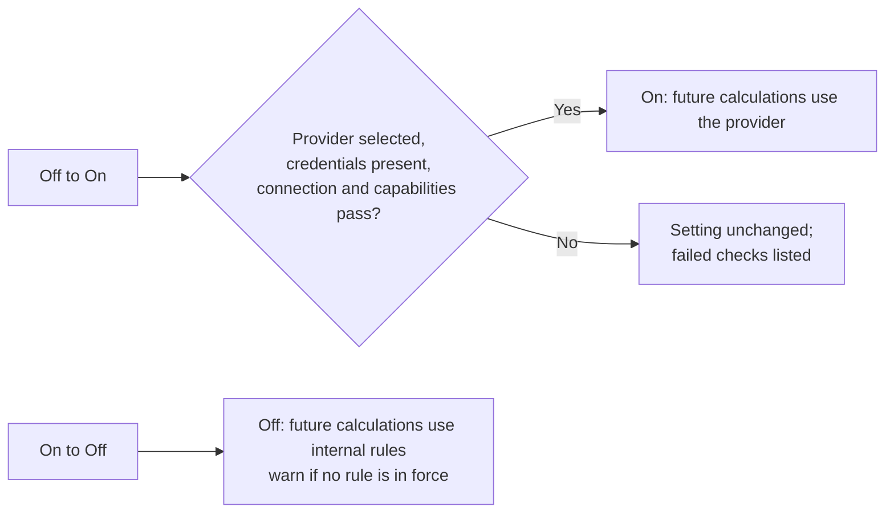

# Workflow — Tax Rules and Calculation (REQ-BIL-002)

## Calculation decision flow
Runs once per invoice, inside `InvoiceService` when an invoice or a credit note is generated.

## Tax rule states

## Switching the engine

Issued invoices are never touched by either change.

## Actors
| Step | Actor |
|---|---|
| Switch engine, manage classes, registrations, provider settings | Platform admin (`MANAGE_BILLING`) |
| Create, edit, submit a rule or exemption | Platform admin |
| Approve or reject | A different platform admin (or the same one when the setting allows it) |
| Retry tax on a Draft invoice | Platform admin |
| Calculate tax | `InvoiceService` (system) through `TaxCalculationService` |
