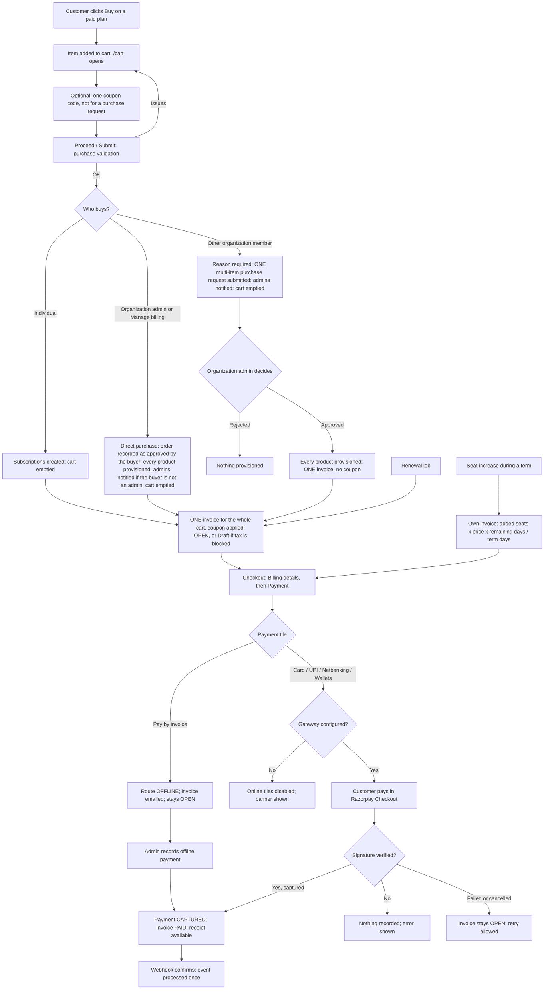
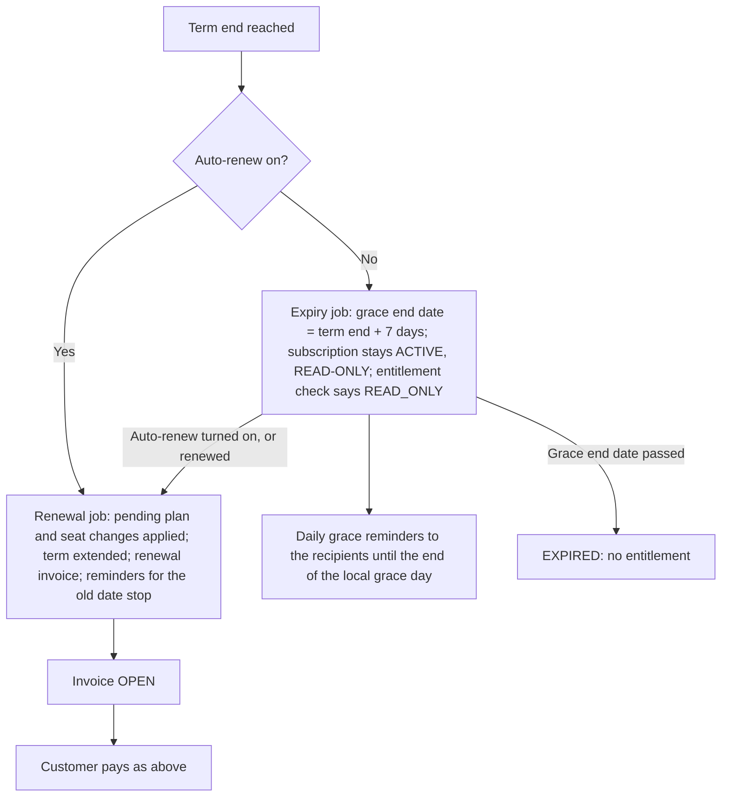

# Workflow — Purchase to payment

Spans Marketplace (03), Subscription (07), Billing & Payments (08) and Order & Provisioning (09). Feature-level states are in [cart-checkout/workflow.md](../02-requirements/FRD/cart-checkout/workflow.md) and [billing-payments/workflow.md](../02-requirements/FRD/billing-payments/workflow.md). Requirements: [REQ-MKT-003](../02-requirements/FRD/cart-checkout/requirement.md) (cart, [C59](../01-business/roadmap/open-decisions.md#c59), [C100](../01-business/roadmap/open-decisions.md#c100), Draft), [REQ-ORD-001](../02-requirements/FRD/order-lifecycle/requirement.md), [REQ-SUB-003](../02-requirements/FRD/subscription-seats/requirement.md), [REQ-SUB-004](../02-requirements/FRD/renewal-reminders/requirement.md) and [REQ-BIL-001](../02-requirements/FRD/billing-payments/requirement.md).

An organization's price is **per seat**: the invoice line is price x seats ([REQ-SUB-003.7](../02-requirements/FRD/subscription-seats/requirement.md)). A seat decrease is stored and applied by the next renewal, which then bills the lower number; it creates no invoice and no credit.

## When the term ends ([C100](../01-business/roadmap/open-decisions.md#c100) RR-1 B, RR-4 A)

Recipients of the reminders for an organization subscription: its administrators, its Manage billing holders and the people an administrator added ([REQ-SUB-004.18](../02-requirements/FRD/renewal-reminders/requirement.md)).

## Open points
- **Activation and payment — decided ([C97](../01-business/roadmap/open-decisions.md#c97) BI-1 C, built 2026-10-13).** A card, UPI, netbanking or wallet purchase from the cart stays PENDING_SUBSCRIPTION until its invoice is PAID, then becomes ACTIVE. Pay by invoice (only for organizations the platform administrator enables, BI-4) and an approved organization order start at once, with the invoice's due date. A tax-blocked Draft invoice cannot be paid, so its purchase stays pending. Activation happens once per subscription. The diagram above shows the invoice and payment steps; the activation points are drawn in [billing-payments/workflow.md](../02-requirements/FRD/billing-payments/workflow.md#when-a-purchase-starts-c97-bi-1). An unpaid OPEN invoice also gets reminders 3 days before, on and 7 days after its due date (BI-2).
- **Several products in one cart — decided ([C100](../01-business/roadmap/open-decisions.md#c100) CA-1 B, built 2026-10-14).** One cart is paid with **one invoice** (one line per product). An organization member's cart becomes **one** multi-item purchase request with a reason; an organization administrator or a Manage billing holder buys directly with no request (the administrators are told when the buyer is not one). A coupon code (one per cart; tax on the discounted amounts) applies to the invoice of a direct or individual purchase, never to a request. See [cart-checkout/workflow.md](../02-requirements/FRD/cart-checkout/workflow.md).
- **Provisioning** ([C56](../01-business/roadmap/open-decisions.md#c56), [REQ-ORD-002](../02-requirements/FRD/provisioning-contract/requirement.md), Draft): once built, subscription start (and suspension, resumption, cancellation) also notifies the hosted product, which reports the tenant back as a service instance ([C57](../01-business/roadmap/open-decisions.md#c57)). Not drawn until the contract is approved.
