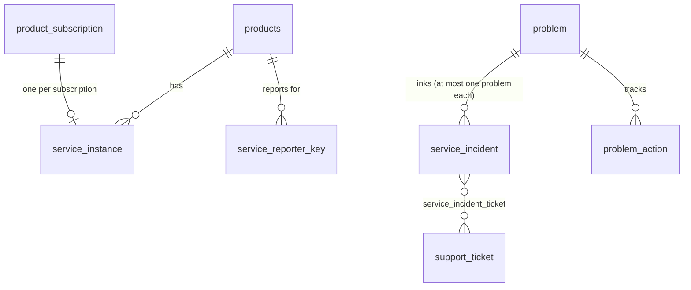

# Data model — Service instances, SLA, incidents and problems

[REQ-SRM-001](../../02-requirements/FRD/service-instances/requirement.md), [REQ-SUP-002](../../02-requirements/FRD/sla-management/requirement.md), [REQ-SUP-003](../../02-requirements/FRD/incident-problem-management/requirement.md). Decision [C101](../../01-business/roadmap/open-decisions.md#c101) (2026-10-14). Migration [`V041__service_instances_sla_incidents_problems.sql`](../../../database/migrations/V041__service_instances_sla_incidents_problems.sql), also in `backend/src/main/resources/db/schema.sql` (Flyway is disabled: apply by hand). **Additive and re-runnable** (`IF NOT EXISTS`, `ON CONFLICT DO NOTHING`); validated on PostgreSQL 16 with a fresh schema load, with the previous schema plus V041, and by running V041 twice. Schema `eis_platform`.

## Service instances (REQ-SRM-001)

### `service_instance`
One row per subscription.

| Column | Description |
|---|---|
| id | BIGSERIAL, primary key |
| subscription_id | BIGINT NOT NULL, **UNIQUE**, references `product_subscription(id)`. One instance per subscription |
| product_id | BIGINT NOT NULL, references `products(id)` |
| owner_customer_id | BIGINT, references `customer(id)`. Set for an individual subscription |
| owner_organization_id | BIGINT, references `organization(id)`. Set for an organization subscription |
| status | VARCHAR(20) NOT NULL DEFAULT `PROVISIONING`, CHECK in `PROVISIONING`, `ACTIVE`, `SUSPENDED`, `FAILED`, `DEPROVISIONED` |
| health | VARCHAR(10) NOT NULL DEFAULT `UNKNOWN`, CHECK in `HEALTHY`, `DEGRADED`, `DOWN`, `UNKNOWN` |
| health_message | VARCHAR(300). The product's short message |
| last_reported_at | TIMESTAMP. Time of the last report (or of a hand-set health); older than 5 minutes = "no recent report" |
| tenant_reference | VARCHAR(100). The product's tenant id |
| access_url | VARCHAR(500) |
| last_changed_by | VARCHAR(10) NOT NULL DEFAULT `SYSTEM`, CHECK in `SYSTEM`, `PRODUCT`, `ADMIN` |
| last_change_note | VARCHAR(300). The administrator's note, or "Subscription {status}" |
| created_at, updated_at | TIMESTAMP NOT NULL DEFAULT now() |

Indexes: `idx_service_instance_product (product_id, status)`, `idx_service_instance_org (owner_organization_id)`.

### `service_reporter_key`
The credential a product uses to report health.

| Column | Description |
|---|---|
| id | BIGSERIAL, primary key |
| product_id | BIGINT NOT NULL, references `products(id)`. The only product the key may report for |
| label | VARCHAR(100), optional |
| key_prefix | VARCHAR(12) NOT NULL. The first 12 characters of the key, to recognise it |
| key_hash | VARCHAR(64) NOT NULL, **UNIQUE**. SHA-256 (hex) of the key. **The key itself is never stored** and is shown once when created |
| created_by_keycloak_sub | VARCHAR(100). The administrator who created it |
| created_at | TIMESTAMP NOT NULL DEFAULT now() |
| last_used_at | TIMESTAMP. Set on each accepted call |
| revoked_at | TIMESTAMP. Set when revoked; a revoked key is refused |

### Product status page
No new table: per-product status is computed from `service_instance` when the status page is read ([BR-SRM-010](../../02-requirements/FRD/service-instances/business-rules.md)). The manually posted status stays in `product_service_status` ([REQ-PRT-001](../../02-requirements/FRD/service-status-page/requirement.md)).

## SLA management (REQ-SUP-002)

### `sla_policy`
One row per ticket priority; the same for every customer and plan.

| Column | Description |
|---|---|
| priority | VARCHAR(20), primary key, CHECK in `LOW`, `MEDIUM`, `HIGH`, `URGENT` |
| first_response_minutes | INTEGER NOT NULL, CHECK > 0 |
| resolution_minutes | INTEGER NOT NULL, CHECK > 0 |
| around_the_clock | BOOLEAN NOT NULL DEFAULT false. True: the minutes run on the clock (24x7); false: business hours only |
| updated_at | TIMESTAMP NOT NULL DEFAULT now() |

Seed (`ON CONFLICT DO NOTHING`): URGENT 60 / 480 around the clock; HIGH 240 / 480; MEDIUM 480 / 1440; LOW 480 / 2400 (business hours; "1 day" = 480 minutes).

### `sla_settings`
A single row (`id = 1`).

| Column | Description |
|---|---|
| id | SMALLINT, primary key DEFAULT 1, CHECK `id = 1` |
| business_days | VARCHAR(30) NOT NULL DEFAULT `MON,TUE,WED,THU,FRI` |
| business_start, business_end | TIME NOT NULL DEFAULT `09:00`, `18:00` |
| time_zone | VARCHAR(60) NOT NULL DEFAULT `Asia/Kolkata` |
| warn_at_percent | INTEGER NOT NULL DEFAULT 80, CHECK between 1 and 99 |
| alert_emails | VARCHAR(1000). Comma-separated addresses (at most 20; the service enforces this) |
| updated_at | TIMESTAMP NOT NULL DEFAULT now() |

### `support_ticket` (new columns)
All nullable timestamps. **Existing tickets keep null in all seven: they have no deadlines.**

| Column | Description |
|---|---|
| first_responded_at | The first time a person took the ticket out of Open (assigned, escalated or resolved it) |
| first_response_due_at | First-response deadline, from the creation time and priority |
| resolution_due_at | Resolution deadline |
| first_response_warned_at, resolution_warned_at | When the 80% warning went out; cleared when the priority changes |
| first_response_breached_at, resolution_breached_at | When the breach was flagged; kept when the priority changes |

## Incidents and problems (REQ-SUP-003)

### `service_incident` (new columns)
The status-page incident table of [V003](../../../database/migrations/V003__service_status_page.sql); the public columns (`title`, `message`, `product_id`, `started_at`, `ended_at`) are unchanged.

| Column | Description |
|---|---|
| phase | VARCHAR(15) NOT NULL DEFAULT `INVESTIGATING`, CHECK in `LOGGED`, `INVESTIGATING`, `RESOLVED`, `CLOSED`. The column default is for rows that existed; the application creates new incidents as `LOGGED` |
| severity | VARCHAR(10) NOT NULL DEFAULT `MINOR`, CHECK in `MINOR`, `MAJOR`, `CRITICAL`. Internal |
| internal_notes | VARCHAR(4000). Internal |
| assigned_to_customer_id | BIGINT. The customer who handles it; no foreign key (checked by the service). Internal |
| resolution_summary | VARCHAR(2000). Internal; required to resolve |
| closed_at | TIMESTAMP. Set when closed |
| problem_id | BIGINT, foreign key `fk_service_incident_problem` to `problem(id)` **ON DELETE SET NULL**. At most one problem per incident |

Backfill in the migration: `UPDATE service_incident SET phase = 'RESOLVED' WHERE ended_at IS NOT NULL AND phase = 'INVESTIGATING'`. The internal columns are never part of the customer API ([BR-INC-002](../../02-requirements/FRD/incident-problem-management/business-rules.md)).

### `service_incident_ticket`
Support tickets linked to an incident.

| Column | Description |
|---|---|
| incident_id | BIGINT NOT NULL, references `service_incident(id)` ON DELETE CASCADE |
| ticket_id | BIGINT NOT NULL, references `support_ticket(id)` ON DELETE CASCADE |
| linked_at | TIMESTAMP NOT NULL DEFAULT now() |
| | Primary key `(incident_id, ticket_id)` |

### `problem`
| Column | Description |
|---|---|
| id | BIGSERIAL, primary key |
| title | VARCHAR(200) NOT NULL |
| description | VARCHAR(4000) |
| status | VARCHAR(25) NOT NULL DEFAULT `OPEN`, CHECK in `OPEN`, `ROOT_CAUSE_IDENTIFIED`, `RESOLVED`, `CLOSED` |
| root_cause | VARCHAR(4000) |
| created_by_keycloak_sub | VARCHAR(100) |
| created_at, updated_at | TIMESTAMP NOT NULL DEFAULT now() |
| resolved_at, closed_at | TIMESTAMP |

### `problem_action`
Corrective actions.

| Column | Description |
|---|---|
| id | BIGSERIAL, primary key |
| problem_id | BIGINT NOT NULL, references `problem(id)` ON DELETE CASCADE. Index `idx_problem_action_problem` |
| description | VARCHAR(500) NOT NULL |
| owner | VARCHAR(100). Free text |
| due_on | DATE |
| done | BOOLEAN NOT NULL DEFAULT false |
| done_at | TIMESTAMP |
| created_at | TIMESTAMP NOT NULL DEFAULT now() |

## Relationships
| From | To | Relationship |
|---|---|---|
| `service_instance` | `product_subscription` | One instance per subscription (`subscription_id` unique) |
| `service_instance` | `products`, `customer`, `organization` | Product, and the individual or organization owner |
| `service_reporter_key` | `products` | A key belongs to one product |
| `support_ticket` | (itself) | Carries the SLA deadlines and marks of its own row |
| `service_incident` | `problem` | Many incidents to at most one problem (`problem_id`, SET NULL on delete) |
| `service_incident` | `support_ticket` | Many-to-many through `service_incident_ticket` |
| `problem` | `problem_action` | One problem has many corrective actions |

`sla_policy` is read by priority when a deadline is calculated; there is no foreign key from a ticket to a policy, and `sla_settings` is a single configuration row.
